# AI PrintOS

**A browser-based print design studio for creating, editing and exporting print-ready layouts.**

AI PrintOS brings an editable design canvas, a large template library, multilingual typing tools and AI-assisted image generation into one lightweight web application. It is built with **HTML, CSS and vanilla JavaScript**, with serverless API routes for private integrations.

<p align="center">
  <a href="https://ai-printos.vercel.app/"><strong>Open Live Application</strong></a>
  &nbsp;·&nbsp;
  <a href="https://github.com/manikantakarthik30-blip/ai-printos"><strong>View Source Code</strong></a>
</p>

## Live Application

| Resource | Link |
|---|---|
| Live deployment | https://ai-printos.vercel.app/ |
| Source repository | https://github.com/manikantakarthik30-blip/ai-printos |
| Deployment platform | Vercel |

## Live Application Features

AI PrintOS is a browser-based design workspace that helps users create print materials, customise layouts and prepare files for download.

- **Design Editor:** Create and customise designs with text, shapes and images; arrange layers and use undo/redo.
- **Template Library:** Browse, search and customise 500 templates across visiting cards, posters, flyers, brochures, banners, labels, product catalogs and invitations.
- **AI Image Generation:** Generate images from text prompts and add them to a design using the Gemini-powered feature.
- **Projects:** Manage designs saved in the browser and reopen them for further editing.
- **Product Catalog:** Explore standard print sizes and dimensions to plan a design.
- **Language Studio & Keyboard:** Work with English, Telugu and Hindi text, including phonetic typing support.
- **Export & Integrations:** Download designs as PNG, PDF, SVG or project JSON, with Canva and Adobe Express integration options.
- **Appearance & Settings:** Switch visual themes and configure available application preferences.

**In short:** AI PrintOS combines a template-driven editor, multilingual text tools and AI-assisted image creation in one web app. Projects are stored locally in the browser; cloud accounts and cloud project sync are not currently provided.

## Application Screenshots

The following screenshots were captured directly from the **live deployed AI PrintOS application** using an automated browser run. They show the actual application interface, not mockups or generated illustrations.

<table>
  <tr>
    <td align="center" width="50%">
      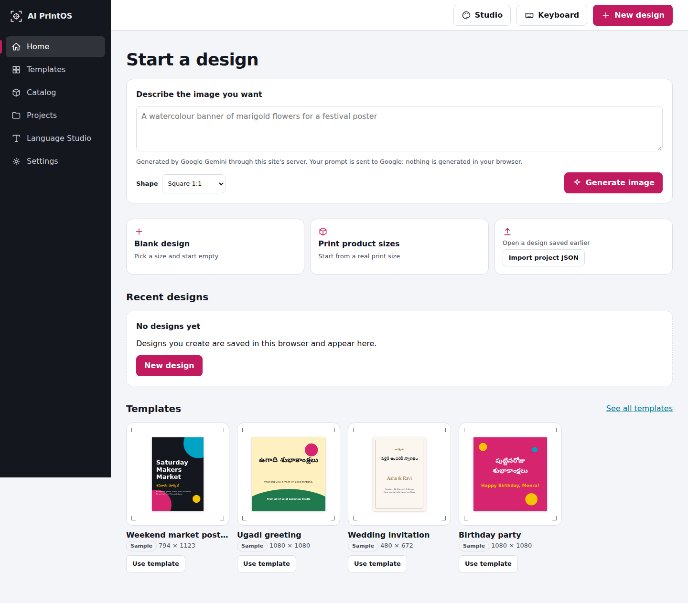
      <br><strong>01 · Home</strong>
    </td>
    <td align="center" width="50%">
      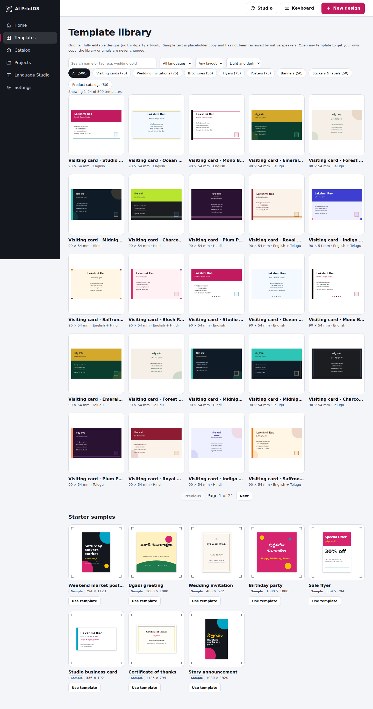
      <br><strong>02 · Templates</strong>
    </td>
  </tr>
  <tr>
    <td align="center" width="50%">
      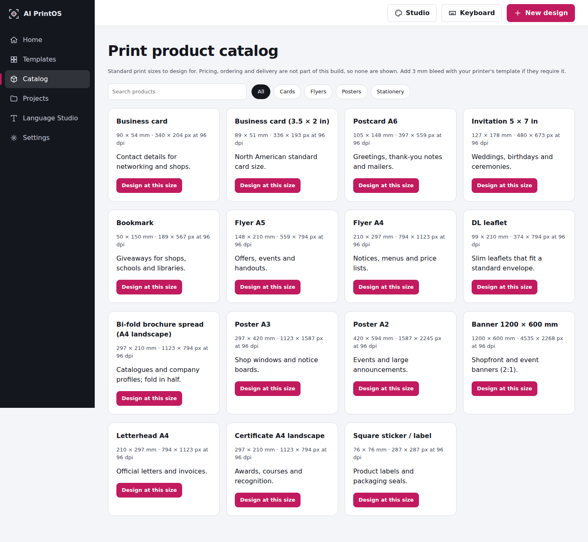
      <br><strong>03 · Product Catalog</strong>
    </td>
    <td align="center" width="50%">
      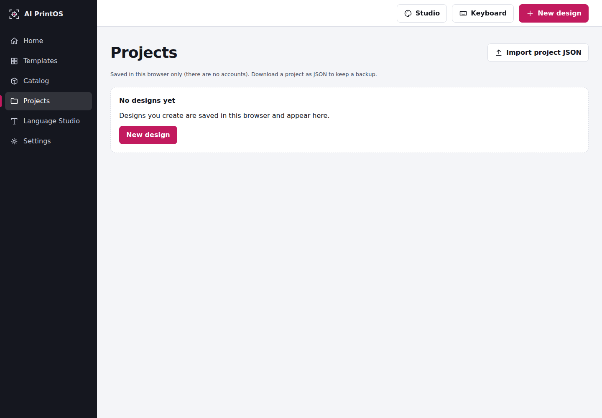
      <br><strong>04 · Projects</strong>
    </td>
  </tr>
  <tr>
    <td align="center" width="50%">
      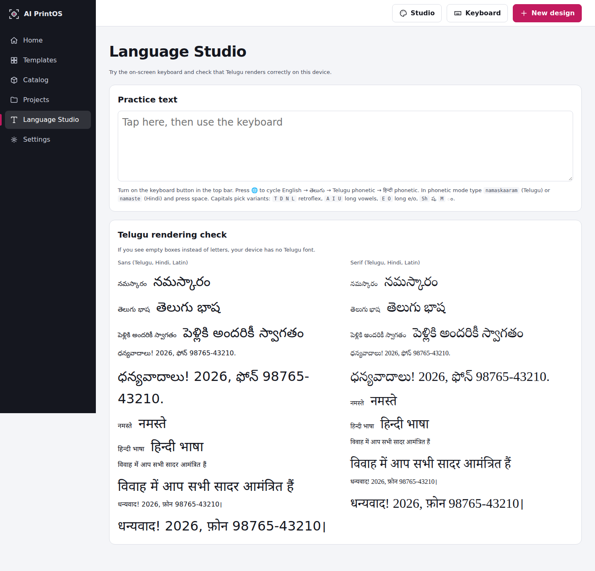
      <br><strong>05 · Language Studio</strong>
    </td>
    <td align="center" width="50%">
      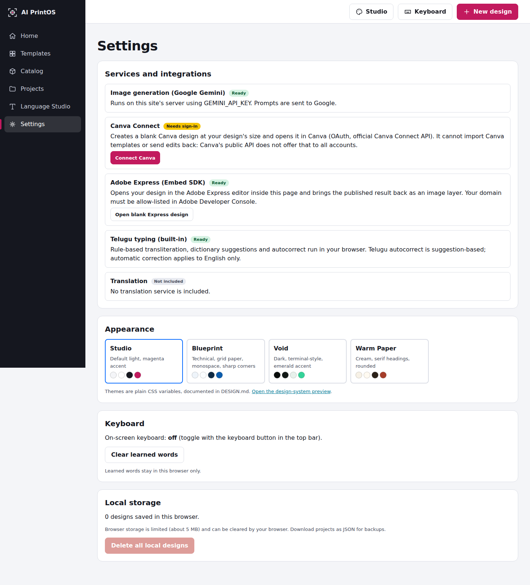
      <br><strong>06 · Settings</strong>
    </td>
  </tr>
  <tr>
    <td align="center" width="50%">
      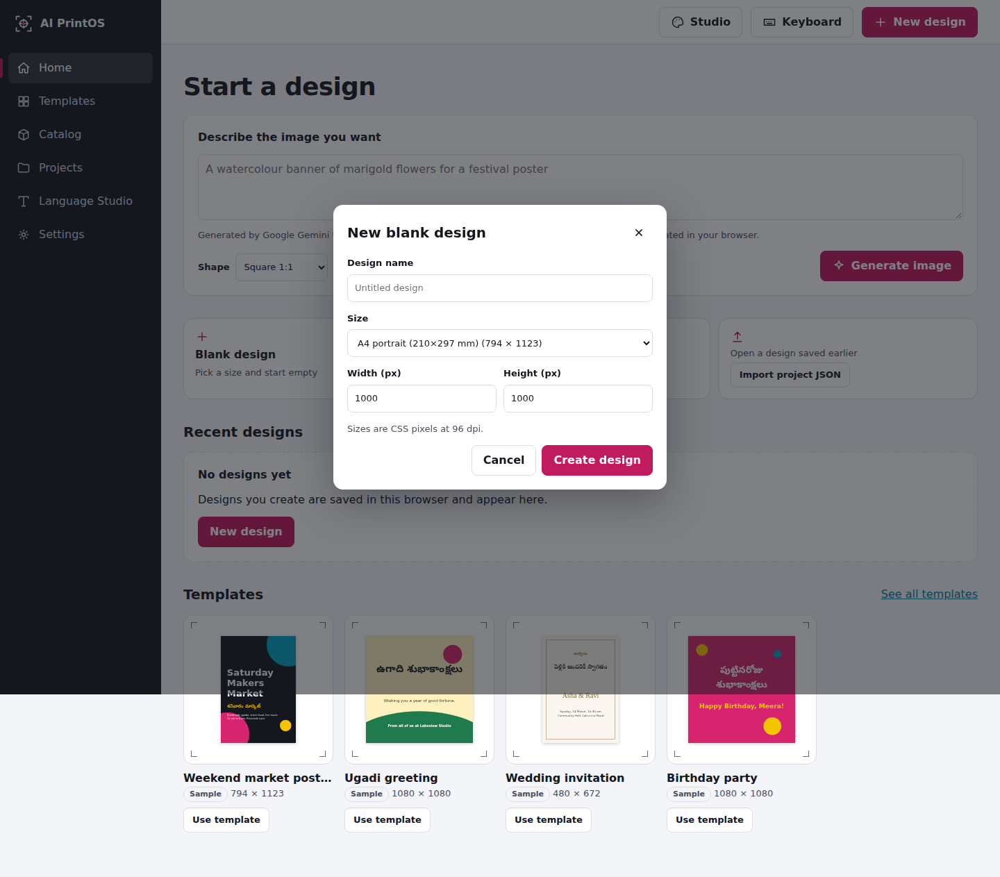
      <br><strong>07 · Design Editor</strong>
    </td>
    <td align="center" width="50%">
      <a href="https://ai-printos.vercel.app/"><strong>Open AI PrintOS</strong></a>
      <br>Explore the live application and create a design.
    </td>
  </tr>
</table>

### Template Preview Gallery

These are real editable template preview assets included in the application repository.

<table>
  <tr>
    <td align="center" width="50%">
      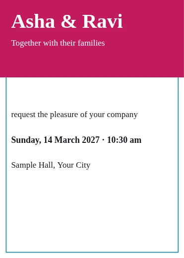
      <br><strong>Wedding Invitation</strong>
    </td>
    <td align="center" width="50%">
      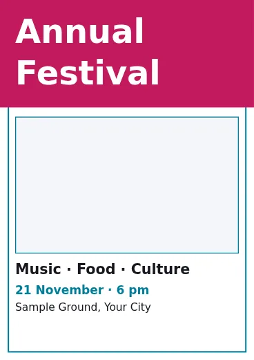
      <br><strong>Poster Design</strong>
    </td>
  </tr>
  <tr>
    <td align="center" width="50%">
      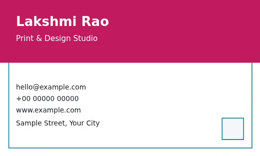
      <br><strong>Visiting Card</strong>
    </td>
    <td align="center" width="50%">
      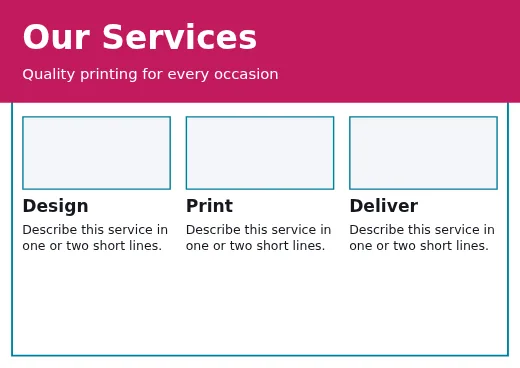
      <br><strong>Brochure</strong>
    </td>
  </tr>
</table>

## Features

| Area | What it does |
|---|---|
| Editor | Text, rectangle, ellipse, image upload, layers (reorder), undo/redo (Ctrl+Z / Ctrl+Y), drag/resize, inspector, size presets, autosave-on-demand to browser storage |
| Export | PNG (1–3×) and PDF (single page, raster) generated in the browser; project JSON backup/import |
| Template library | **500 original, editable templates**: visiting cards 75, wedding invitations 75, brochures 50, flyers 75, posters 75, banners 50, stickers/labels 50, product catalogs 50. Search, filters, preview, open-as-copy (originals never change), SVG/JSON download. Each has size in mm, bleed/safe area, provenance, licence and honest print-validation status. Plus 8 starter samples |
| Text review | Local, opt-in: English spelling (bundled en_US word list), Telugu/Hindi Unicode checks, spacing; protects emails, URLs, phones, prices, dates, codes; never edits without your click |
| Guides + SVG | Trim / bleed / safe-area guides; editable SVG export |
| Product catalog | 15 standard print sizes (mm and px). Specs only: no prices or ordering, because there is no backend for them |
| AI images | Google Gemini via `/api/generate-image`: loading, cancel, success, error, retry, download, use in design |
| Keyboard | Gboard-style glassmorphism keyboard: English, Telugu (native layout), Telugu phonetic, Hindi phonetic, autocorrect (English), suggestions, next-word prediction, emoji, learns your words locally |
| Design system | `DESIGN.md` (9-section format) + 4 CSS-variable themes (Studio, Blueprint, Void dark, Warm Paper) + live token preview at `#/design`; switch from the top bar or Settings |
| Canva | Official Canva Connect OAuth (PKCE): creates a blank Canva design at your size and opens it |
| Adobe Express | Official Embed SDK: edit the current design in Express and bring the result back as an image layer |

## Project layout

```
public/            static site (publish directory)
  index.html  css/  js/
    main.js        router, navigation, global listeners
    editor.js      document editing, undo/redo, inspector, canvas interaction
    render.js model.js storage.js
    views/         pages.js (all pages + project actions + integrations), ai.js (Gemini UI)
    services/      api.js (client for /api), export.js, pdf.js (PDF writer), adobe.js
    keyboard/      keyboard.js, layouts.js, translit.js, predict.js, lexicon.js
    data/          templates.js, catalog.js
    core/theme.js  theme switcher (css/themes.css holds the themes)
DESIGN.md          the design-system document (tokens and rules)
lib/router.js      all server logic (Gemini proxy, Canva OAuth), platform-neutral
api/[name].js     Vercel adapter           netlify/functions/api.js   Netlify adapter
scripts/dev-server.js   zero-dependency local server (static + API)
tests/             Node tests (npm test) and optional browser tests (tests/e2e, Python Playwright)
```

## Run locally

Requires Node 18+.

```bash
cp .env.example .env      # then add GEMINI_API_KEY (and optionally Canva/Adobe values)
npm run dev               # http://localhost:3000  (serves public/ and /api/*)
npm test                  # Node tests
```

`vercel dev` and `netlify dev` also work. A plain static server (e.g. `python3 -m http.server -d public`) shows the editor, but AI images and Canva are disabled because `/api` is missing; the Settings page says so.

## Environment variables

See `.env.example`. **Never commit `.env`** and never put keys in files under `public/`.

| Variable | Needed for |
|---|---|
| `GEMINI_API_KEY` | AI images (get one in Google AI Studio) |
| `GEMINI_IMAGE_MODEL` | Optional; default `gemini-2.5-flash-image`. Any Gemini model that returns images from `generateContent` |
| `CANVA_CLIENT_ID`, `CANVA_CLIENT_SECRET`, `CANVA_REDIRECT_URI` | Canva Connect |
| `ADOBE_EXPRESS_CLIENT_ID`, `ADOBE_EXPRESS_APP_NAME` | Adobe Express Embed SDK (client ID is public by design) |
| `ALLOWED_ORIGINS` | Optional comma-separated Origin allow-list for POST requests |

## Deploy

### Vercel
1. Push the project to a Git repo and import it in Vercel (Framework preset: **Other**). `vercel.json` sets `public/` as the output directory and `maxDuration` 60 s for functions.
2. Project → Settings → Environment Variables: add the variables above, then redeploy.
3. Canva only: register `https://<your-domain>/api/canva-callback` as the redirect URL. Adobe only: add your domain to the allow-list in Adobe Developer Console.

### Netlify
1. New site from Git. `netlify.toml` sets publish dir `public`, functions dir `netlify/functions`, and rewrites `/api/*` to the function.
2. Site configuration → Environment variables: add the variables above, then redeploy.
3. **Platform difference:** Netlify synchronous functions default to a 10 s timeout, and image generation can take longer. Raise the function timeout in your Netlify plan/settings if you see `504 timeout` errors. Vercel is configured for 60 s.

Both `vercel.json` and `netlify.toml` send security headers including a Content-Security-Policy. If you change which Adobe domains are used, adjust the CSP there.

## Canva and Adobe Express: what is and is not possible

* **Canva** (official *Canva Connect APIs*): requires a Canva developer integration (client ID/secret, redirect URL, scopes `design:content:write design:meta:read`). This build can create a blank design at your size and open it. It does **not** import Canva templates, and edits made in Canva are **not** synced back. Autofilling Canva brand templates needs a Canva Enterprise plan and extra API code that is not included. The Canva access token is kept in an HttpOnly cookie for its short lifetime; refresh tokens are not implemented. For production use, store tokens server-side.
* **Adobe Express** (official *Embed SDK*): requires an Adobe Developer Console project with the Embed SDK enabled and your domain allow-listed. This build sends a PNG of your design to Express and adds the published result as an image layer.
* **Neither integration has been run against live credentials in this build.** The server side of Canva and request guards are unit-tested with mocked network calls; the Adobe SDK call shapes follow Adobe's documented API but are unverified here. Verify both with your own credentials before relying on them.

## Keyboard

Turn it on with the **Keyboard** button in the top bar (on by default on touch devices). It appears when you focus any text field, including the editor's text box, search boxes and the AI prompt. 🌐 cycles English → తెలుగు → phonetic.

* **Phonetic Telugu:** type `namaskaaram`, press space → నమస్కారం. Capitals choose variants: `T D N L` retroflex, `A I U` long vowels, `E O` long e/o, `Sh` ష, `M` ం. Suggestions show dictionary matches.
* **English:** autocorrect on space/punctuation (backspace right after reverts and teaches it to leave the word alone), double-space inserts a period, auto-capitalisation, next-word prediction.
* Telugu autocorrect is **suggestion-based only**; automatic correction applies to English. The built-in dictionaries are small (a few hundred English words, ~80 Telugu words) and grow with the words you type (stored in your browser only; clear them in Settings).
* Not implemented: long-press alternate characters, swipe typing, voice input.

## Security notes

* Secrets exist only in server environment variables. `GET /api/config` returns booleans plus the public Adobe client ID only.
* POST endpoints require a custom header and JSON body; no CORS headers are sent, so other websites cannot call them from a browser. Add rate limiting (e.g. your platform's WAF) before exposing AI generation publicly: the endpoint spends your Gemini quota and has **no per-user authentication**.
* Imported JSON and stored projects are validated; only data-URL images are accepted. All user text is HTML-escaped when rendered.

## Known limitations

* No accounts and no cloud storage: projects live in this browser (about 5 MB limit; images are downscaled to fit). Download JSON for backups.
* PDF export is a single raster page (text is not selectable). No bleed/crop marks, CMYK, or multi-page documents.
* No print ordering, pricing, or inventory.
* Telugu text needs a Telugu-capable font on the device (shown in Language Studio).
* Gemini output is AI-generated: review before printing.

## Tests

`npm test` runs 32 Node tests (transliteration incl. Hindi, autocorrect/predictions, text review, PDF validity, API handlers with mocked upstreams, document validation, and template-library integrity: counts, unique IDs, files exist, SVG well-formed, duplicate detection, validation status). `tests/e2e/*.py` (editor/export, keyboard, AI/catalog/settings, library workflow) are optional browser tests (Python `playwright`), run against `npm run dev`.

## Template library (how it was made, how to regenerate)
* `scripts/generate-templates.js` writes the editor-native JSON for all 500 templates plus `public/templates/manifest.json`. It builds 3 skeletons x 6 decorations x 12 palettes x 5 language modes (English, Telugu, Hindi, English+Telugu, English+Hindi) per category and **fails on** duplicate designs, low text contrast (AA 4.5:1) or text outside the safe area.
* `scripts/bake-templates.py` (needs Python Playwright + the dev server) renders every template with the bundled fonts to produce `<id>.svg` and `<id>.webp` previews, and records the text-fit check in the manifest.
* **Honest description:** these are parametric designs (about 18 layouts per category, recoloured and translated), not 500 hand-drawn artworks. Every one is structurally unique, but expect family resemblance. The Telugu and Hindi sample sentences have **not** been reviewed by native speakers.
* **Not press-ready:** trim size, safe area and contrast are checked. Bleed artwork, CMYK conversion, font outlining and PDF/X are not, and exports are trimmed (no bleed). Use a professional prepress check before printing.
* Third-party licence audit: `docs/LICENCE_AUDIT.md`. Notices: `THIRD_PARTY_NOTICES.md`.

## Languages
English, Telugu and Hindi render with bundled Noto fonts (loaded only when needed). Spelling: English only. Telugu/Hindi: Unicode and spacing checks (the open te_IN/hi_IN dictionaries are GPL and were not bundled). Grammar review and remote text services are not included. Hindi typing is phonetic only (no native Devanagari key layout).
